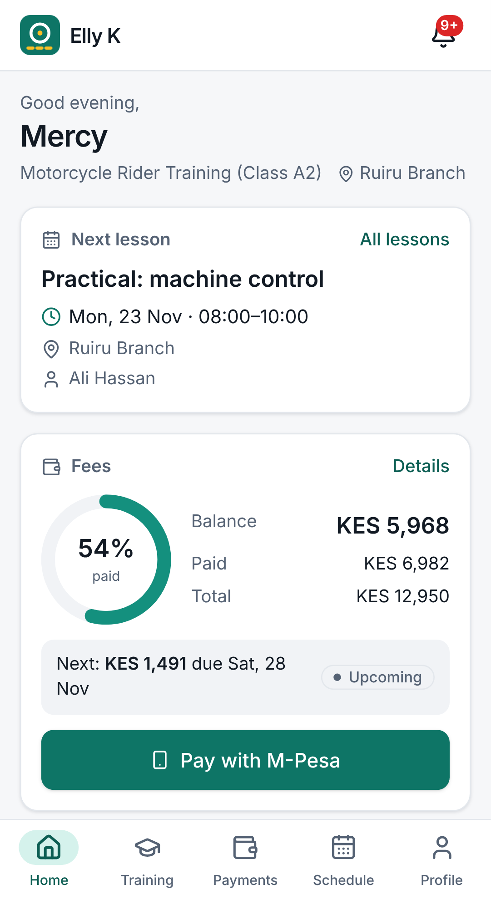
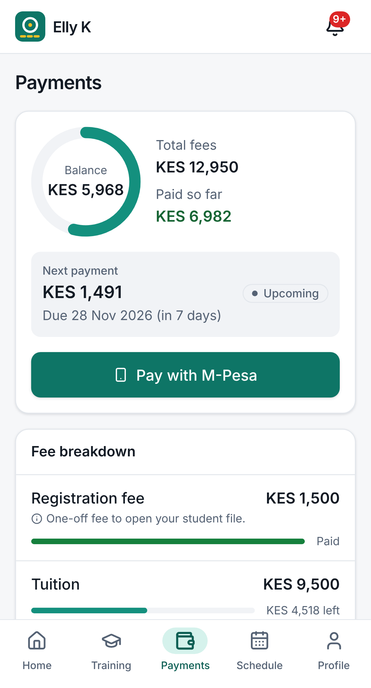
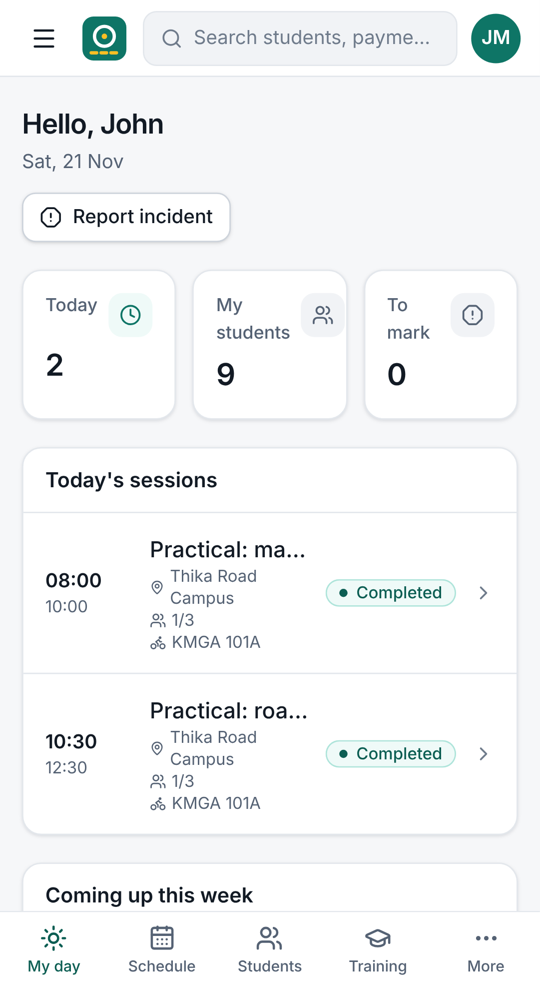
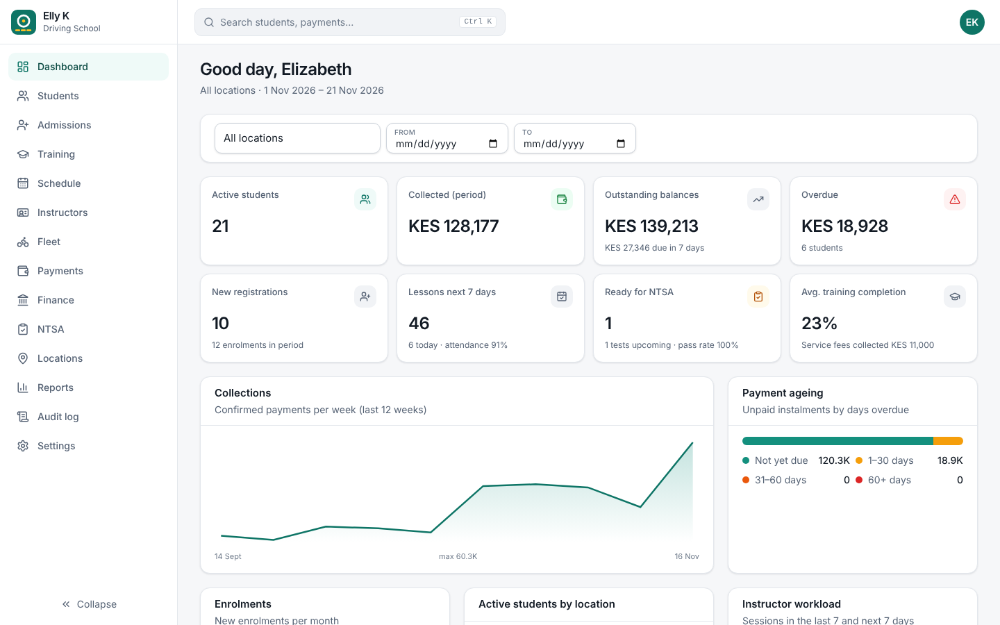
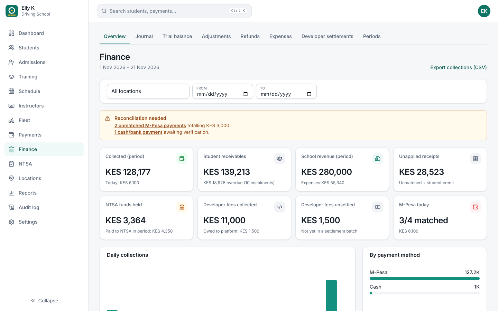

# Elly K Driving School Management System

A complete management system for **Elly K Driving School** (Kenya): admissions CRM, student records, versioned course pricing, interest-free instalment plans, **M-Pesa Paybill** reconciliation, a **double-entry ledger**, a separately tracked **platform service fee**, NTSA workflow, scheduling, attendance, competency tracking, fleet, notifications, reports, and a **mobile-first student PWA** that installs on Android without the Play Store.

The three design priorities:

1. **Operational simplicity.** Step-by-step workflows, plain language, few taps on phones.
2. **Financial transparency.** Every shilling is traceable from the M-Pesa receipt to its allocation, owner (school, NTSA, platform) and remaining balance.
3. **Excellent student mobile experience.** On a low-cost Android phone, students see their course, next lesson, progress, what they've paid, what they owe, their next payment and their NTSA status.

| Student home (phone) | Student payments (phone) | Instructor "My day" (phone) |
| --- | --- | --- |
|  |  |  |




---

## Contents

- [Tech stack](#tech-stack)
- [Architecture at a glance](#architecture-at-a-glance)
- [Local setup](#local-setup)
- [Environment variables](#environment-variables)
- [Database: migrations, types, seed](#database-migrations-types-seed)
- [Running tests](#running-tests)
- [M-Pesa integration](#m-pesa-integration)
- [Deployment](#deployment)
- [PWA](#pwa)
- [Roles](#roles)
- [Security model](#security-model)
- [Further documentation](#further-documentation)

## Tech stack

| Layer | Choice |
| --- | --- |
| App | Next.js 16 (App Router, Server Components, Server Actions), React 19, TypeScript strict |
| UI | Tailwind CSS v4 with CSS-variable design tokens, Radix primitives, Lucide icons, Sonner toasts, server-rendered SVG charts (no chart library) |
| Validation | Zod (client and server), with the database re-validating every financial invariant |
| Backend | Supabase: PostgreSQL 17, Auth (with TOTP MFA), Storage (private buckets), Row Level Security |
| Tests | Vitest (unit and integration against a real local Postgres), Playwright (desktop and Pixel 5 projects) |
| Integrations | Safaricom Daraja C2B, Africa's Talking SMS, Resend email, Web Push (all behind adapters with an honest sandbox mode) |

`cacheComponents` is deliberately **off**: nearly every screen shows live, per-user financial data that must never be served stale.

## Architecture at a glance

```
Browser / installed PWA
   │  (Server Components render with the user's session → RLS applies)
   ▼
Next.js (src/app)  ── Server Actions (src/features/*/actions.ts) ──┐
   │  src/proxy.ts refreshes the session and blocks signed-out users │
   ▼                                                                ▼
Supabase PostgREST ── RLS policies + SECURITY DEFINER business functions
   │  (all money movement happens inside single-transaction SQL functions)
   ▼
PostgreSQL: append-only ledger, allocations, audit log, derived balance views

Safaricom ──► /api/mpesa/c2b/{validation,confirmation}?token=… ──► service-role RPC (idempotent)
Cron      ──► /api/cron/notifications (Bearer CRON_SECRET) ──► reminders + SMS/email/push outbox
```

Business rules live in Postgres, so they hold no matter which client calls them. The TypeScript layer handles UX, input validation and the pure calculations (`src/lib/finance/schedule.ts`), and the database re-checks those invariants. See [docs/ARCHITECTURE.md](docs/ARCHITECTURE.md).

## Local setup

Prerequisites: Node 22+, pnpm 10+, Docker (for the local Supabase stack).

```bash
pnpm install
```

```bash
pnpm db:start
```

`db:start` runs `supabase start` without the services this app doesn't need. If your network blocks `public.ecr.aws`, pull from Docker Hub instead:

```bash
SUPABASE_INTERNAL_IMAGE_REGISTRY=docker.io pnpm db:start
```

```bash
cp .env.example .env.local
```

Fill `.env.local` from the output of `npx supabase status -o env`: `API_URL` → `NEXT_PUBLIC_SUPABASE_URL`, `ANON_KEY`, `SERVICE_ROLE_KEY`. Set `MPESA_CALLBACK_TOKEN`, `MPESA_SHORTCODE=600999` and `CRON_SECRET` to any long random strings for development.

```bash
pnpm db:reset && pnpm seed
```

```bash
pnpm dev
```

Open http://localhost:3000. Demo accounts (password `EllyK-Demo-2026!`; all data is fictional):

| Role | Sign in with |
| --- | --- |
| Manager | `manager@ellyk.test` |
| Administrator (Thika Road + Ruiru) | `admin@ellyk.test` |
| Administrator (Kitengela) | `admin.ktg@ellyk.test` |
| Accountant | `accounts@ellyk.test` |
| Instructor | `john.mwangi@ellyk.test` (also `ruth.akinyi@…`, `ali.hassan@…`) |
| Platform owner | `platform@ellyk.test` |
| Student | `EK00004` or phone `0700 100 513` (students sign in with student number or phone) |

New students activate their own account at `/activate` using a 6-digit code issued from their staff record.

## Environment variables

See [.env.example](.env.example). Summary:

| Variable | Purpose |
| --- | --- |
| `NEXT_PUBLIC_SUPABASE_URL`, `NEXT_PUBLIC_SUPABASE_ANON_KEY` | Public Supabase connection (RLS-protected) |
| `SUPABASE_SERVICE_ROLE_KEY` | **Server-only.** Used only for M-Pesa callbacks, cron, auth-user administration and login-identifier resolution |
| `NEXT_PUBLIC_APP_URL` | Public base URL (callback URLs, reset links) |
| `MPESA_ENV`, `MPESA_SHORTCODE`, `MPESA_CALLBACK_TOKEN`, `MPESA_CONSUMER_KEY/SECRET`, `MPESA_ALLOWED_IPS` | Daraja C2B ([docs/MPESA.md](docs/MPESA.md)) |
| `SMS_PROVIDER`, `AFRICASTALKING_*`, `EMAIL_PROVIDER`, `RESEND_API_KEY`, `EMAIL_FROM`, `*_VAPID_*` | Notification providers; unset means sandbox (logged, not sent) |
| `CRON_SECRET` | Protects `/api/cron/notifications` |

Secrets are only ever read from the environment. They are never stored in the database or shown in the UI.

## Database: migrations, types, seed

- Migrations live in `supabase/migrations` (the schema is never edited through a dashboard):
  1. `…01_foundation`: roles, locations, settings, numbering, audit log, RLS helpers, rate limiter
  2. `…02_catalog_people`: licence classes, courses, **versioned prices**, instructors, CRM, students, enrolments, agreements, plans
  3. `…03_finance`: chart of accounts, journal (balanced and immutable), invoices, payments, allocations, M-Pesa, refunds, adjustments, expenses, developer settlements, eTIMS queue
  4. `…04_operations`: NTSA, fleet, sessions (with conflict-exclusion constraints), bookings, attendance, competencies, notifications
  5. `…05_views`: derived balances (lines, enrolments, instalments, credit, NTSA funds, developer-fee ledger, trial balance, progress)
  6. `…06_finance_functions`: enrolment acceptance, allocation waterfall, M-Pesa intake, reconciliation, adjustments, refunds, settlements
  7. `…07_operations_functions`: training gate, attendance, competencies, NTSA workflow, completion, scheduled notifications, dashboards, platform-owner reporting, search, anonymisation
  8. `…08_rls_storage`: RLS policies for every table, workflow-column guards, storage buckets, notification templates, function grants
- `pnpm db:reset` re-applies everything. `pnpm db:types` regenerates `src/lib/supabase/database.types.ts`.
- `pnpm seed` creates 3 locations, 2 courses with published pricing, staff in every role, 26 students across the whole lifecycle, ~200 sessions with attendance, M-Pesa payments (matched, unmatched, reassigned), cash payments, NTSA cases at every stage, a graduate, expenses, a developer settlement, leads, an incident and an announcement. **All of it goes through the real business functions**, so balances and journals are genuine. The seed refuses to run when `APP_ENV=production`.

Schema details: [docs/DATABASE.md](docs/DATABASE.md).

## Running tests

```bash
pnpm typecheck
```

```bash
pnpm lint
```

```bash
pnpm test
```

```bash
pnpm test:integration
```

```bash
pnpm build && pnpm test:e2e
```

| Suite | What it covers |
| --- | --- |
| Unit (41) | Instalment schedule (no interest, rounding, dates), allocation planner, outstanding and instalment derivation, phone/KES/date formatting, M-Pesa payload validation, privacy masking, replay window, CSV formula-injection escaping |
| Integration (39) | Enrolment acceptance and journals; M-Pesa allocation order, idempotency, shortcode check; parity between SQL allocation and the TS preview; overpayment credit; reconciliation; reversals; second-person cash verification; waivers; NTSA funds; developer-fee settlement; ledger balance; **RLS for every role**; immutability guards; scheduling conflicts; training payment gate; attendance permissions; competency sign-off; NTSA transitions; callback handler security |
| E2E (16 × desktop + mobile) | Student sign-in and navigation, payments, receipt, schedule, progress; admin registration wizard, enrolment, activation code; scheduling a lesson; instructor attendance and competency rating; accountant reconciliation via the sandbox; outstanding report CSV; manager dashboard filters, reports, responsive nav; PWA manifest, service worker and offline page; public enquiry form |

Integration and E2E tests need the local stack running and seeded. E2E resets the login rate limiter before each sign-in for local runs only (`E2E_RESET_RATE_LIMITS=0` disables that).

## M-Pesa integration

Students pay through **Paybill**, using their **student number** as the account number. Callbacks are authenticated with a secret URL token, optionally IP-allow-listed, schema-validated, shortcode-checked, replay-window checked and **idempotent on TransID**. Unknown account numbers go to an **Unmatched** queue for finance to reconcile, with a full audit trail. In sandbox mode, `/staff/payments/simulator` pushes Daraja-shaped callbacks through the same code path. Full details: [docs/MPESA.md](docs/MPESA.md).

## Deployment

1. **Supabase:** create a project, then run `npx supabase link --project-ref <ref>` and `npx supabase db push`. Turn off public sign-ups (the app creates all accounts) and enable TOTP MFA. Set the Site URL to your domain.
2. **Vercel (or any Node host):** set all variables from `.env.example`, with `APP_ENV=production` and `MPESA_ENV=production` when going live. `vercel.json` schedules `/api/cron/notifications` every 15 minutes. Vercel sends `Authorization: Bearer $CRON_SECRET` automatically when `CRON_SECRET` is set.
3. **Daraja:** go to Settings → Integrations → "Register C2B URLs" (or register them manually) with the token-bearing URLs.
4. Configure the school profile, KRA PIN, Paybill, courses and pricing, competencies and staff in **Settings**. Nothing business-related is hard-coded.

## PWA

Manifest (`src/app/manifest.ts`), maskable icons, service worker (`public/sw.js`), offline page, update prompt and Android install prompt. Student pages are network-first, with recently viewed schedule, progress, profile and payment summary available offline. Staff pages and APIs are never cached, and the cache is wiped at sign-in and sign-out. See [docs/PWA.md](docs/PWA.md).

## Roles

| Role | Can do |
| --- | --- |
| **Platform owner** | Service-fee dashboard, fee ledger (student numbers only), settlements, integration health, audit log. **No access to student personal data or school finances** unless a school role is explicitly granted. |
| **Manager** | Everything school-side across all locations, including users and roles, pricing, overrides, withdrawals and anonymisation |
| **Administrator / reception** | Leads, registration, enrolment, documents, scheduling, NTSA administration and recording payments for verification, limited to **assigned locations** |
| **Accountant** | Payments, reconciliation, adjustments, refunds, expenses, NTSA remittances, developer settlements, periods, financial reports |
| **Instructor** | Their own sessions, assigned and booked students, attendance, competency assessments, fleet, incidents, reschedule requests. **No finance.** |
| **Student** | Their own course, schedule, progress, fees, receipts, NTSA status, documents and notifications |

Full matrix: [docs/PERMISSIONS.md](docs/PERMISSIONS.md).

## Security model

- **RLS on every table**, with SECURITY DEFINER helper functions and no reliance on hidden menus. Server pages also check roles.
- **Money moves only through SECURITY DEFINER functions** with explicit role checks, inside one transaction. No role has insert/update policies on the ledger, payments or allocations.
- **Append-only finance:** journal entries, lines, allocations, adjustments, expenses and agreements are immutable (triggers block it even for the service role). Corrections are reversing entries. Each journal must balance at commit (deferred constraint trigger). Closed fiscal periods reject postings.
- **Workflow-column guards** stop direct API edits of statuses, numbers and amounts.
- **Segregation of duties:** cash recorded by one person is verified by another. Refunds can't be approved by their requester.
- **Audit log:** append-only, with actor, roles, IP, user agent and before/after values. Sensitive fields are redacted.
- **Privacy (Kenya DPA 2019):** consent records, ID numbers held in a separate table and masked (reveals are audited), masked/hashed M-Pesa phone numbers, private storage with 60-second signed URLs, configurable retention, and a controlled anonymisation workflow.
- **Auth:** Supabase Auth, TOTP MFA for staff (optionally enforced), forced password change for temporary passwords, a Postgres-backed rate limiter on sign-in, activation and public forms, and open-redirect protection.
- **HTTP:** CSP, HSTS, `frame-ancestors 'none'`, `nosniff` and a strict referrer policy. Server Actions are CSRF-protected by Next.js origin checks.
- Uploads are validated by size, MIME type **and magic bytes**.

## Further documentation

- [docs/ARCHITECTURE.md](docs/ARCHITECTURE.md)
- [docs/DATABASE.md](docs/DATABASE.md)
- [docs/PERMISSIONS.md](docs/PERMISSIONS.md)
- [docs/FINANCE.md](docs/FINANCE.md)
- [docs/MPESA.md](docs/MPESA.md)
- [docs/NTSA-WORKFLOW.md](docs/NTSA-WORKFLOW.md)
- [docs/PWA.md](docs/PWA.md)
